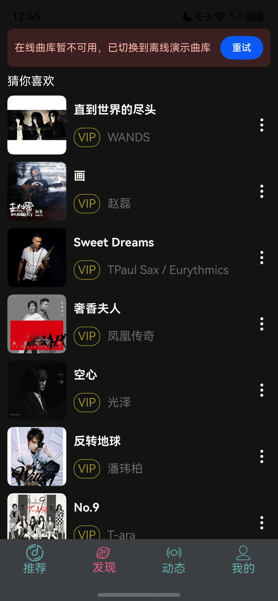
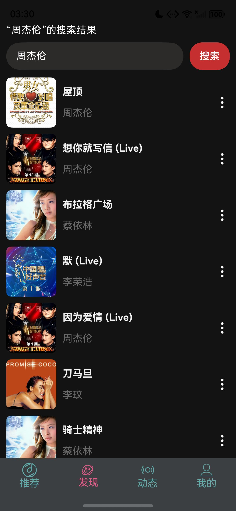
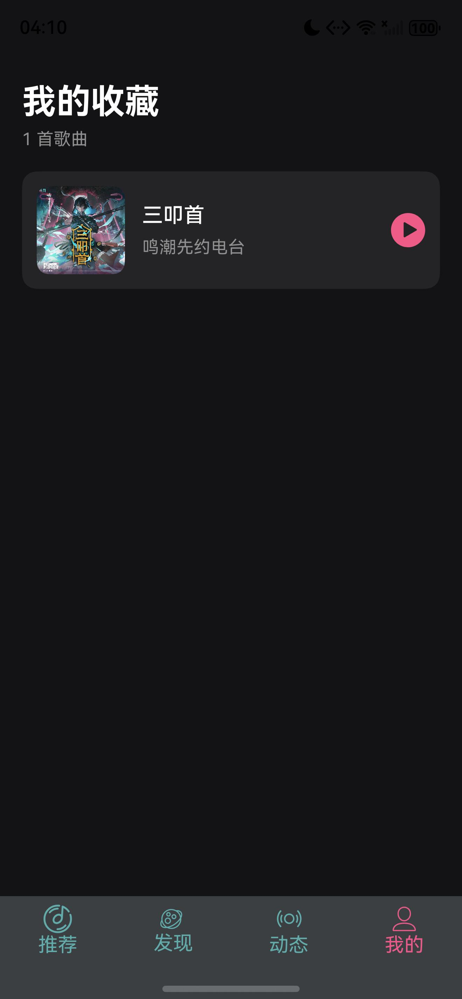

# MyMusic｜HarmonyOS 云音乐应用

基于 ArkTS 与 ArkUI 构建的 HarmonyOS 音乐客户端。项目重点不只是页面展示，而是围绕真实播放器场景处理网络请求、音频生命周期、后台播放、并发点击和状态持久化。

## 运行效果

| 推荐页 | 离线演示曲库 |
|---|---|
|  |  |

| 播放页 | 系统媒体卡片 |
|---|---|
|  |  |

| 歌曲搜索 | 在线歌单 | 在线歌曲播放 |
|---|---|---|
|  |  |  |

| 全局迷你播放器 | 我的收藏 |
|---|---|
|  |  |

## 核心能力

- 随机推荐、歌曲/歌手关键词搜索与动态内容展示
- 推荐页所有入口均连接真实歌曲列表，不保留无功能扫码、假播放量或占位搜索框
- AVPlayer 音频播放、暂停、拖动进度、上一首/下一首
- 四个主标签共享全局迷你播放器，可暂停、继续、切换下一首并进入完整播放页
- 顺序、随机、单曲循环三种播放模式，并使用 Preferences 持久化；随机切歌会避开当前歌曲
- 歌曲收藏、取消收藏与独立收藏列表，支持从收藏页直接播放，重启应用后仍保留状态
- AVSession 系统媒体会话与后台音频任务
- 播放通知与系统播控联动
- 清空队列时移除过期系统媒体卡片，再次播放时自动重建会话
- AppStorageV2 驱动的跨页面播放状态同步
- 会话级标签页状态保存，从播放页返回时仍停留在用户原来的主标签
- 对连续点击、过期网络响应和重复播放页导航进行并发保护
- 请求超时、资源释放、空列表与异常状态兜底
- 在线接口不可用时自动切换到可播放的离线演示曲库
- 在线队列在首次点击、上下首、播放列表和系统播控入口按需解析歌曲地址，并自动跳过无可用地址的歌曲
- 搜索无结果或请求失败时保留原歌单，避免用户当前内容被清空

## 技术设计

项目按 `Page → ViewModel → Service/Repository → Platform API` 分层：

- **Page**：负责 ArkUI 页面渲染和用户交互。
- **ViewModel**：管理页面状态、播放意图和导航决策。
- **Service / Repository**：封装音乐接口、Preferences 与通知能力。
- **Manager**：集中管理 AVPlayer、AVSession 等系统资源及其生命周期。

播放链路采用递增序号识别最新用户意图。在“解析真实歌曲地址”和“重置播放器”两个异步边界后重新校验序号，避免用户快速连续点击时旧请求覆盖新歌曲。

## 工程质量

- 32 个 Hypium 单元测试覆盖时间格式化、播放模式、队列边界、完整队列构建、在线地址解析、搜索状态、收藏增删与去重、不可播放歌曲跳过策略、无立即重复的确定性随机策略与 AI 安全开关
- 收藏使用共享响应式状态驱动播放页与“我的收藏”同步，并通过 Preferences 完成跨启动恢复
- 网络请求统一设置连接/读取超时，并在 `finally` 中释放请求对象
- 页面消失时清理延时任务，降低生命周期越界风险
- 静态媒体资源使用 HTTPS
- AI 密钥不进入客户端仓库；服务端代理完成前不向用户展示未完成入口

## 目录结构

```text
entry/src/main/ets/
├─ pages/          # 页面与交互
├─ viewmodels/     # 页面状态和业务编排
├─ services/       # 音乐、通知等服务
├─ repository/     # 本地设置持久化
├─ utils/          # 播放器、媒体会话、网络工具
└─ models/         # 领域模型与共享状态
```

## 本地运行

1. 使用 DevEco Studio 打开项目。
2. 等待 SDK 与依赖同步完成。
3. 如需连接电脑上的本地音乐服务，将 `entry/src/main/ets/config/ApiConfig.ets` 中的开发地址改为设备可访问的局域网地址；不要提交账号、密钥或个人网络配置。
4. 选择 phone、tablet 或 2in1 设备运行 `entry` 模块；服务不可用时会自动进入离线演示曲库。
5. 单元测试位于 `entry/src/test`，真机验收表位于 `docs/release-checklist.md`。

## 学习与面试复盘

- 核心源码阅读：`docs/core-source-guide.md`
- 项目架构与生命周期：`docs/day02-project-architecture.md`
- 面试掌握清单：`docs/interview-review-checklist.md`

## 当前边界与下一步

- 在线音乐数据依赖外部接口；接口不可用时会保留重试入口并切换到离线演示曲库。
- AI 推荐暂未启用，后续应由自建服务端代理大模型请求，避免在端侧保存密钥。
- 下一阶段计划补充 Mock 网络测试、实体机功耗与性能数据，以及 60～90 秒演示视频。

> 本项目用于 HarmonyOS 客户端工程实践与求职作品展示，请勿将第三方音乐资源用于商业用途。
