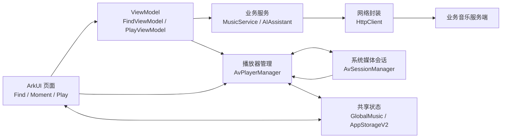
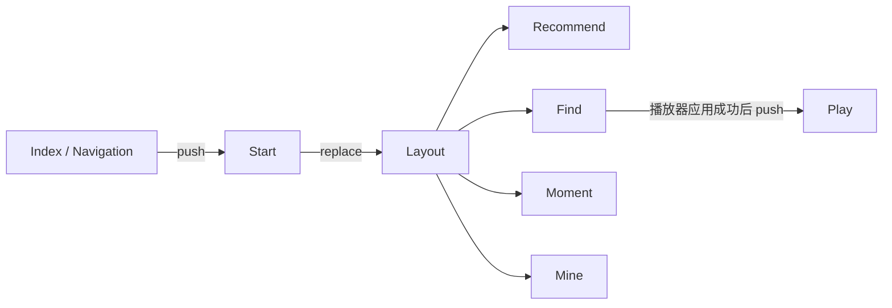
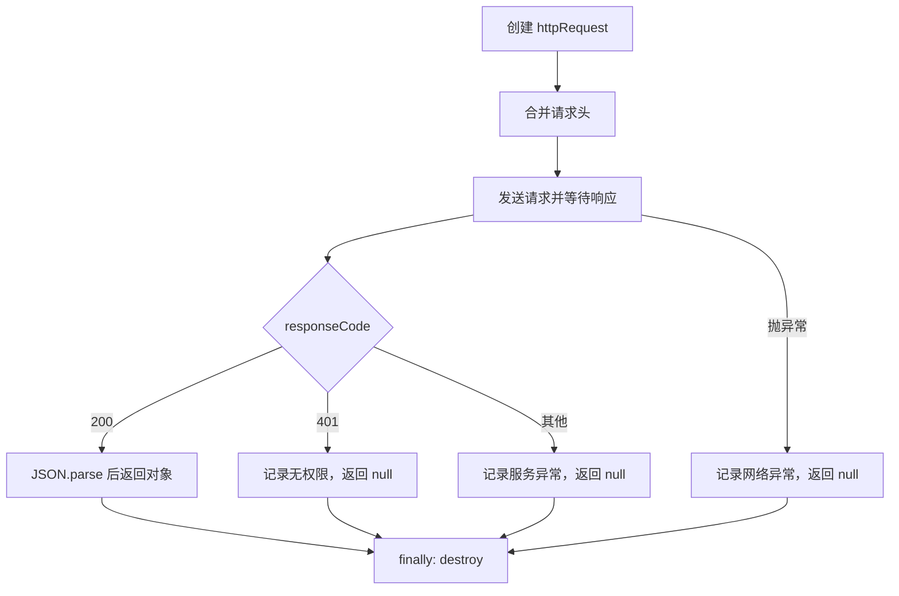
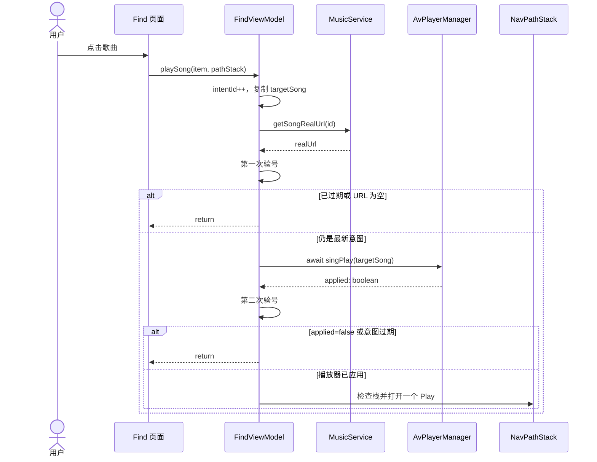
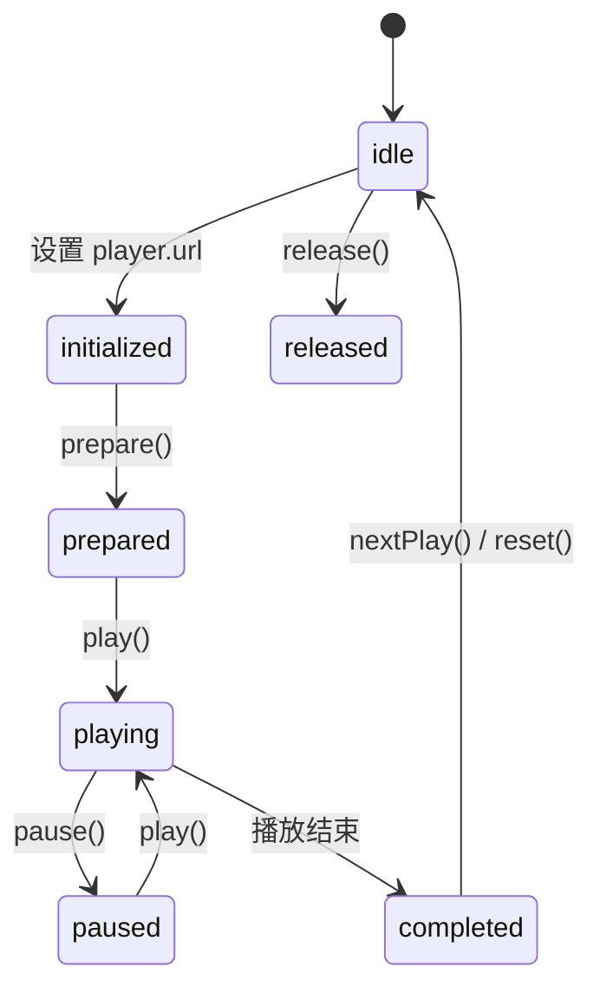

# Mymusic 核心源码阅读指南

> 适用项目：Mymusic / Harmony-CloudMusic
>
> 技术栈：HarmonyOS NEXT、ArkTS、ArkUI、MVVM、AppStorageV2、AVPlayer、AVSession、HTTP
>
> 目标 SDK：HarmonyOS 6.0.2（API 22）

## 1. 这份文档解决什么问题

这份文档不按文件名机械罗列代码，而是按一首歌从“出现在页面”到“真正发出声音”的过程解释核心源码。

读完后应该能够回答：

- 应用从哪里启动，为什么先进入 Start，再进入 Layout？
- 推荐、发现、动态、我的四个 Tab 是怎样固定对应页面的？
- 歌曲列表、当前歌曲和播放状态分别存在哪里？
- 点击歌曲后，为什么要先获取真实 URL？
- 快速点击 A、B 两首歌时，怎样保证最后只播放 B？
- 为什么 FindViewModel 和 AvPlayerManager 各自需要一个序列号？
- AVPlayer、AVSession、后台长时任务分别负责什么？
- Play 页面为什么能自动跟随当前歌曲刷新？
- 出现播放失败、页面与声音不一致时，应从哪些日志开始排查？

## 2. 一句话理解当前架构

当前工程是一个以 MVVM 为主、播放页面直接复用 Manager 的实用型分层架构：



需要注意：

- Find 页主要通过 `FindViewModel` 处理业务。
- Moment 和 Play 的播放操作直接调用 `AvPlayerManager`。
- 所有播放入口最后都汇合到 `AvPlayerManager.singPlay()`。
- 页面与管理器通过同一个 `GlobalMusic` 实例共享播放状态。

## 3. 核心目录地图

| 目录/文件 | 主要职责 | 阅读重点 |
|---|---|---|
| [`EntryAbility.ets`](../entry/src/main/ets/entryability/EntryAbility.ets) | 应用生命周期、初始化/释放音频资源 | `initializeAudio()`、`onWindowStageCreate()` |
| [`Index.ets`](../entry/src/main/ets/pages/Index.ets) | 根 Navigation 与全局 NavPathStack | `AppStorageV2.connect(..., 'navStack')` |
| [`Start.ets`](../entry/src/main/ets/pages/Start.ets) | 启动广告页、进入 Layout | `replacePathByName('Layout')` |
| [`Layout.ets`](../entry/src/main/ets/pages/Layout.ets) | 四个主 Tab | `index` 与 `currentIndex` 的区别 |
| [`Find.ets`](../entry/src/main/ets/pages/Find.ets) | 发现页 UI | ViewModel 状态绑定、歌曲点击 |
| [`Moment.ets`](../entry/src/main/ets/pages/Moment.ets) | 动态页 UI | 直接调用播放器管理器 |
| [`Play.ets`](../entry/src/main/ets/pages/Play.ets) | 播放详情、进度、上下首、播放列表 | 空列表保护、异步结果处理 |
| [`FindViewModel.ets`](../entry/src/main/ets/viewmodels/FindViewModel.ets) | 发现页业务与网络播放意图 | `playIntentSequence` |
| [`PlayViewModel.ets`](../entry/src/main/ets/viewmodels/PlayViewModel.ets) | 时间格式、进度拖动、列表面板 | UI 辅助状态 |
| [`MusicService.ets`](../entry/src/main/ets/services/MusicService.ets) | 搜索歌曲、随机推荐、获取真实 URL | 服务端响应转为 `SongItemType` |
| [`HttpClient.ets`](../entry/src/main/ets/utils/HttpClient.ets) | HTTP 创建、请求、解析、销毁 | 超时、错误返回、资源释放 |
| [`AvPlayerManager.ets`](../entry/src/main/ets/utils/AvPlayerManager.ets) | AVPlayer、播放列表、切歌并发控制 | `playOperationSequence`、`changeSong()` |
| [`AvSessionManager.ets`](../entry/src/main/ets/utils/AvSessionManager.ets) | 锁屏播控、蓝牙播控、后台长时任务 | 元数据、系统事件、任务真实状态 |
| [`globalMusic.ets`](../entry/src/main/ets/models/globalMusic.ets) | 全局播放状态模型 | `@ObservedV2`、`@Trace` |
| [`music.ets`](../entry/src/main/ets/models/music.ets) | 单首歌曲的数据结构 | `SongItemType` |
| [`cache.ets`](../entry/src/main/ets/models/cache.ets) | 发现页歌曲缓存 | `FindPageCache.songs` |
| [`ApiConfig.ets`](../entry/src/main/ets/config/ApiConfig.ets) | 开发/生产服务端配置、AI 开关 | 不保存第三方密钥 |
| [`router_map.json`](../entry/src/main/resources/base/profile/router_map.json) | 命名路由注册 | Start、Layout、Play |

## 4. 应用启动与导航流程

### 4.1 EntryAbility：应用的生命周期入口

`EntryAbility.onWindowStageCreate()` 做两件互不阻塞的事：

1. 启动音频初始化。
2. 加载根页面 `pages/Index`。

音频初始化顺序为：

```text
playerManager.init()
  -> sessionManager.init(context)
```

先创建播放器，再创建 AVSession。这样锁屏或蓝牙耳机发来播放指令时，播放器已经具备接收能力。

销毁顺序相反：

```text
sessionManager.destroy()
  -> playerManager.release()
```

先撤销系统会话和后台任务，再释放真正播放声音的对象。

### 4.2 Index：全应用只有一个根 Navigation

`Index.ets` 使用：

```ts
AppStorageV2.connect(NavPathStack, 'navStack', () => new NavPathStack())
```

这意味着使用相同 key `navStack` 的页面拿到的是同一个导航栈。应用出现时把 `Start` 压入栈中。

### 4.3 Start：用 replace 进入主页面

Start 页等待三秒或用户点击“跳过”后调用：

```ts
replacePathByName('Layout', null, false)
```

这里使用 replace 而不是 push，因此进入 Layout 后按返回键不会重新回到广告页。

### 4.4 Layout：四个 Tab 的固定身份

Layout 中有两个容易混淆的变量：

- `index`：当前循环项的固定身份。
- `currentIndex`：用户当前选中的位置。

正确关系是：

| index | 固定页面 |
|---:|---|
| 0 | Recommend |
| 1 | Find |
| 2 | Moment |
| 3 | Mine |

`currentIndex` 只控制图标和文字是否高亮。不能用它决定所有 `TabContent` 的内容，否则切到发现页时，多个 Tab 都可能构建 Find。

ForEach 使用 `item.text` 作为稳定 key，帮助 ArkUI 在刷新时识别同一个 Tab 实例。

### 4.5 路由结构



`router_map.json` 注册了 `Start`、`Layout`、`Play` 三个命名路由。

## 5. 数据模型与响应式状态

### 5.1 SongItemType：单首歌曲

```ts
interface SongItemType {
  id: string
  name: string
  author: string
  img: string
  url: string
}
```

搜索结果刚返回时 `url` 通常为空。用户真正点击歌曲后，再通过歌曲 ID 请求可播放 URL。

### 5.2 GlobalMusic：整个应用共享的播放状态

`GlobalMusic` 使用 `@ObservedV2`，字段使用 `@Trace`。页面只要连接同一个实例，字段变化就会触发对应 UI 刷新。

| 字段 | 含义 |
|---|---|
| `img` | 当前歌曲封面 |
| `name` | 当前歌曲名 |
| `author` | 当前歌手 |
| `url` | 当前真实播放地址 |
| `time` | 当前播放进度，毫秒 |
| `duration` | 总时长，毫秒 |
| `playIndex` | 当前歌曲在播放列表中的索引 |
| `playList` | 播放列表 |
| `isPlay` | 是否正在播放 |
| `playMode` | `auto`、`random` 或 `repeat` |

以下代码在多个位置使用相同 key：

```ts
AppStorageV2.connect(GlobalMusic, 'SONG_KEY', () => new GlobalMusic())
```

因此 AvPlayerManager、AvSessionManager、Find 和 Play 看到的是同一份状态。

### 5.3 FindPageCache：发现页列表缓存

`FindPageCache.songs` 保存发现页加载出来的歌曲。Find 再次出现时，如果缓存非空，就不重复请求随机推荐。

播放时不会直接把真实 URL 写回这个缓存，而是复制 `targetSong` 快照。这样网络播放过程不会修改列表的原始数据对象。

### 5.4 @Local、@Trace 与普通字段

| 类型 | 使用场景 | 示例 |
|---|---|---|
| `@Local` | 当前组件的 UI 状态 | `Layout.currentIndex` |
| `@Trace` | `@ObservedV2` 对象中需要驱动 UI 的字段 | `GlobalMusic.isPlay` |
| 普通私有字段 | 只做内部计算，不驱动 UI | `playIntentSequence` |

序列号如果使用 `@Trace`，每次点击都会产生没有意义的响应式刷新，所以它们保持普通私有字段。

## 6. 网络层：从请求到歌曲模型

### 6.1 ApiConfig

`ApiConfig.MUSIC_API_BASE` 根据 `IS_PROD` 选择开发或生产业务服务端。

- `IS_PROD=false`：使用本地开发地址。
- `IS_PROD=true`：使用 HTTPS 生产地址。
- `ENABLE_AI=false`：AI 服务端代理完成前关闭 AI。

客户端不能存储第三方 AI 密钥。正确调用路径应是：

```text
HarmonyOS 客户端
  -> 自己的业务后端
  -> 后端读取环境变量中的第三方密钥
  -> 第三方 AI API
```

### 6.2 HttpClient

`HttpClient.request()` 的完整生命周期：



无论成功还是失败，`finally` 都会执行 `httpRequest.destroy()`，避免系统网络对象泄漏。

### 6.3 MusicService

MusicService 把服务端格式转换为应用内部格式。

#### searchMusic(keyword)

1. 对关键词执行 `encodeURIComponent`。
2. 请求 `/cloudsearch`。
3. 把服务端歌曲映射为 `SongItemType`。
4. 搜索阶段把 `url` 留空。

#### getRandomMusic(authors)

随机选择一个歌手，再复用 `searchMusic()`。它是“选择搜索词”的封装，不重复实现 HTTP 请求。

#### getSongRealUrl(id)

请求 `/song/url/v1`，从结果中取出真实 URL。失败时返回空字符串，由上层决定不播放、不导航。

### 6.4 AIAssistant

当前 AI 是安全降级状态：

- 空输入返回输入提示。
- 正常输入返回“正在进行安全后端改造”。
- 不保存第三方密钥。
- 不直接向第三方 AI 发网络请求。

## 7. 发现页：歌曲怎样进入播放器

### 7.1 Find 页面负责什么

Find 主要负责 UI：

- 展示加载状态和歌曲列表。
- 绑定 `FindViewModel` 的输入框、AI 和刷新状态。
- 把点击事件交给 `FindViewModel.playSong()`。
- 使用 `runTask()` 接住异步异常，避免未处理 Promise。

### 7.2 FindViewModel 的 UI 状态

| 字段 | 用途 |
|---|---|
| `isLoading` | 首次加载歌曲 |
| `isRefreshing` | 下拉刷新 |
| `userInput` | AI 输入框 |
| `isAILoading` | AI 请求状态 |
| `aiKeyword` | AI 推荐关键词 |
| `aiReason` | AI 推荐理由 |

### 7.3 playIntentSequence：网络层的取号机

用户快速点击 A、B 时，两个 URL 请求可能乱序返回。解决方法是每次点击取一个递增号码：

```ts
const intentId = ++this.playIntentSequence
```

只允许号码等于当前最大号码的操作继续。

歌曲 ID 不能代替 intentId，因为连续点击同一首歌时，歌曲 ID 相同，但它们仍是两次不同的用户操作。

### 7.4 playSong() 完整流程



每个 `await` 都是一个异步边界。等待期间用户可以再次点击，所以每次重要等待结束后都要重新验号。

### 7.5 导航去重

`openPlayPageOnce()` 先读取：

```ts
pathStack.getAllPathName()
```

如果栈中已经包含 `Play`，就不再 push。这样导航结构保持为：

```text
Layout -> Play
```

而不会变成：

```text
Layout -> Play -> Play
```

这里读取真实导航栈，比维护一个永久布尔值可靠。页面返回、替换后，真实栈会自动反映当前状态。

## 8. AvPlayerManager：真正的播放核心

### 8.1 它管理两类对象

- `player`：HarmonyOS 的 `media.AVPlayer`，真正输出声音。
- `currentSong`：页面观察的 `GlobalMusic`，决定 UI 显示什么。

两者必须在同一次有效操作中一起更新。否则就可能出现页面显示 B、声音仍播放 A。

### 8.2 为什么还需要 playOperationSequence

`FindViewModel.playIntentSequence` 只能保护发现页。以下入口不经过它：

- Moment 页歌曲点击。
- Play 页播放列表点击。
- 上一首、下一首。
- 自动下一首。
- AVSession 锁屏或蓝牙播控。

所以播放器内部还有自己的全局播放操作序列：

```ts
const operationId = ++this.playOperationSequence
```

它保护所有进入播放器的操作。

### 8.3 init() 与播放器状态回调

init 创建 AVPlayer，并注册三个监听：

| 监听 | 作用 |
|---|---|
| `stateChange` | prepare、play、暂停、播放完成等状态转换 |
| `durationUpdate` | 更新总时长和 AVSession 元数据 |
| `timeUpdate` | 更新当前播放进度 |

主要状态流：



### 8.4 singPlay() 的判断顺序

1. 生成新的 operationId。
2. 检查播放器是否初始化。
3. 检查歌曲对象与 URL。
4. 复制歌曲快照。
5. 等待后台任务申请。
6. 检查 operationId 是否过期。
7. 如果 URL 与当前资源相同，直接恢复播放。
8. 否则进入 `changeSong()`。
9. changeSong 返回后再次检查 operationId。
10. 成功返回 true，失败或被新操作淘汰返回 false。

返回 boolean 的意义是让上层知道“播放器是否真的接受并应用了这次操作”，而不是只知道方法调用过。

### 8.5 changeSong() 为什么先 reset，再更新页面

正确顺序：

```text
保存局部 player
  -> await player.reset()
  -> 检查 operationId
  -> 设置 player.url
  -> 更新播放列表
  -> 一次性更新 GlobalMusic
```

不能在 reset 前就更新 GlobalMusic。reset 可能失败，也可能在等待期间被更新操作淘汰。如果提前更新，页面会先显示一首尚未真正交给播放器的歌曲。

### 8.6 播放列表更新

`upsertPlayListSong()` 按歌曲 ID 查找：

- 已存在：替换整条歌曲快照，更新真实 URL。
- 不存在：插入列表头部。

切歌经过 await 后不依赖旧索引，而是重新按 ID 查找位置，降低列表在等待期间发生变化造成的错误。

### 8.7 同一 URL 恢复播放

如果目标 URL 已经是当前 URL：

- 不执行 reset。
- 调用 play 恢复播放。
- 更新歌曲快照和当前索引。
- 返回 true。

这可以避免暂停后恢复时产生不必要的中断。

### 8.8 上一首、下一首与播放模式

| 模式 | 上一首/下一首行为 |
|---|---|
| `auto` | 按列表顺序循环 |
| `random` | 随机选择索引 |
| `repeat` | 自动播放完成时保持当前歌曲 |

prev/next 先用局部变量计算目标索引，不提前修改全局 `playIndex`。最终由成功的播放操作统一提交状态。

### 8.9 removeSong()

删除逻辑分三类：

1. 删除的不是当前歌曲：只删除列表项，并根据位置修正 playIndex。
2. 删除当前歌曲且列表还有其他歌：选择下一首并等待 `singPlay()`。
3. 删除最后一首：创建新的操作号、reset 播放器、确认未过期，再执行 `GlobalMusic.reset()`。

所有路径都先检查空列表和索引上下界。

## 9. AvSessionManager：系统播控与后台播放

### 9.1 AVSession 与 AVPlayer 的区别

| 对象 | 职责 |
|---|---|
| AVPlayer | 加载 URL、播放声音、暂停、seek、reset |
| AVSession | 锁屏卡片、通知栏、蓝牙耳机和系统媒体控制中心 |

AVSession 不直接播放音频。它收到系统操作后，仍然调用 AvPlayerManager。

### 9.2 系统事件映射

| AVSession 事件 | 转发目标 |
|---|---|
| `play` | `playerManager.resumePlay()` |
| `pause` | `playerManager.paused()` |
| `playPrevious` | `playerManager.prevPlay()` |
| `playNext` | `playerManager.nextPlay()` |
| `seek` | 更新进度并调用 `seekPlay()` |

上一首和下一首返回 Promise，`handlePlaybackAction()` 负责接住 boolean 和异常。

### 9.3 元数据与播放状态

`setAVMetadata()` 向锁屏卡片推送：

- 歌曲 ID。
- 歌名。
- 歌手。
- 封面。
- 总时长。

`setAVPlayBackState()` 推送：

- 播放或暂停。
- 当前进度。
- 更新时间。
- 总时长。

### 9.4 后台长时任务

`startBackgroundTask()` 的 `isTaskRunning` 必须代表真实状态：

- 申请成功：设置 true。
- 系统返回 9800005，表示任务已经存在：保持 true。
- 其他失败：设置 false，使后续播放可以重试。

后台任务申请失败不会阻止前台播放；AvPlayerManager 会记录日志并继续当前前台操作。

## 10. Play 页面与 PlayViewModel

### 10.1 Play 页面

Play 连接 `SONG_KEY`，所以 GlobalMusic 更新后，封面、歌名、进度、播放按钮和列表会自动刷新。

页面中的核心操作：

- 暂停或恢复当前歌曲。
- 上一首、下一首。
- 修改播放模式。
- 拖动进度。
- 打开/关闭播放列表面板。
- 点击播放列表切歌。
- 滑动删除歌曲。

`handlePlaybackAction()` 统一处理播放器 Promise，避免 UI 回调静默丢失异常。

播放按钮读取 `playList[playIndex]` 前会检查：

- 列表是否为空。
- 索引是否小于 0。
- 索引是否超出数组长度。

### 10.2 PlayViewModel

PlayViewModel 只负责播放页的 UI 辅助逻辑：

- `number2time()`：把毫秒转换成 `mm:ss`。
- `showListPanel()`：显示播放列表面板。
- `hideListPanel()`：隐藏播放列表面板。
- `handleSeek()`：更新进度并通知播放器 seek。

真正的播放和并发控制不放在 PlayViewModel，而是在 AvPlayerManager 中统一处理。

## 11. 四条最重要的完整调用链

### 11.1 应用启动

```text
EntryAbility.onWindowStageCreate
  -> initializeAudio
     -> playerManager.init
     -> sessionManager.init
  -> loadContent('pages/Index')
  -> Index push Start
  -> Start replace Layout
```

### 11.2 发现页点击歌曲

```text
Find.onClick
  -> FindViewModel.playSong
  -> getSongRealUrl
  -> 检查 playIntentSequence
  -> playerManager.singPlay
  -> 检查 playOperationSequence
  -> player.reset
  -> player.url = targetSong.url
  -> 更新 GlobalMusic
  -> 返回 true
  -> 导航去重
  -> push Play
```

### 11.3 点击下一首

```text
Play / AVSession
  -> playerManager.nextPlay
  -> 计算目标索引
  -> singPlay
  -> changeSong
  -> GlobalMusic 刷新
  -> Play 页面自动更新
```

### 11.4 删除最后一首歌

```text
Play 删除按钮
  -> playerManager.removeSong
  -> 新 operationId
  -> await player.reset
  -> 确认操作未过期
  -> GlobalMusic.reset
  -> 返回 true
  -> Play 检测列表为空
  -> pop 返回 Layout
```

## 12. 两个序列号的区别

| 序列号 | 所在层 | 保护范围 | 不能替代什么 |
|---|---|---|---|
| `playIntentSequence` | FindViewModel | 发现页 URL 请求和点击意图 | 不能保护 Moment、上下首、系统播控 |
| `playOperationSequence` | AvPlayerManager | 所有进入播放器的操作 | 不负责导航栈中是否已有 Play |

此外还有第三个独立控制域：导航栈。它通过 `getAllPathName()` 查询真实页面状态，不能用上述任一序列号代替。

## 13. 日志怎么读

| 日志前缀 | 所属范围 | 用途 |
|---|---|---|
| `[PlayIntent][n]` | 发现页网络意图 | 判断哪个 URL 请求过期 |
| `[PlayerOperation][n]` | 播放器操作 | 判断哪个 reset/切歌被淘汰 |
| `[Navigation]` | 导航栈 | 判断 Play 是否被重复 push |
| `[AvPlayerManager]` | 播放器通用状态 | 初始化、空列表、播放失败 |
| `[AVSession]` | 系统媒体会话 | 元数据、播放状态、系统播控 |
| `[AvSessionManager]` | 后台任务和会话生命周期 | 任务申请、停止、销毁 |

快速点击 A、B 时，理想日志特征：

```text
[PlayIntent][1] 开始解析歌曲URL：A
[PlayIntent][2] 开始解析歌曲URL：B
[PlayIntent][1] 网络结果过期...
[PlayerOperation][2] 开始reset：B
[PlayerOperation][2] 已应用最新URL：B
[PlayIntent][2] 最终有效...
[Navigation] 首次进入Play页面
```

## 14. 常见问题排查

### 14.1 点击歌曲没有进入 Play

按顺序检查：

1. `getSongRealUrl()` 是否返回空字符串。
2. `[PlayIntent]` 是否显示操作已过期。
3. `playerManager.singPlay()` 是否返回 false。
4. 播放器是否尚未初始化。
5. `[Navigation]` 是否发现 Play 已经存在。

### 14.2 页面显示的歌曲和声音不一致

重点检查：

- 旧 `[PlayerOperation]` 是否在 reset 后被正确丢弃。
- 是否有人绕过 `singPlay()` 直接修改 GlobalMusic。
- 是否在 `player.url` 设置成功前提前更新页面状态。

### 14.3 上一首或下一首崩溃

检查：

- playList 是否为空。
- playIndex 是否越界。
- 删除歌曲后是否仍使用旧索引。
- 调用方是否处理了 Promise<boolean>。

### 14.4 出现两个 Play 页面

搜索所有：

```text
pushPathByName('Play'
```

正常情况下，发现页只能通过 `openPlayPageOnce()` 导航，并且跳转前应打印真实导航栈。

### 14.5 锁屏控制无反应

检查：

- `sessionManager.init()` 是否成功。
- AVSession 是否 activate。
- `registerEvent()` 是否成功注册。
- 系统回调是否进入 AvPlayerManager。
- 当前设备是否支持后台音频长时任务能力。

## 15. 建议的源码阅读顺序

第一次阅读建议按以下顺序：

1. `music.ets`：先认识一首歌的数据结构。
2. `globalMusic.ets`：理解全局播放状态。
3. `Index.ets`、`Start.ets`、`Layout.ets`：理解应用页面骨架。
4. `Find.ets`：看 UI 如何绑定 ViewModel。
5. `MusicService.ets`：看歌曲如何从服务端进入应用。
6. `FindViewModel.ets`：理解网络意图与导航。
7. `AvPlayerManager.ets`：理解真正的播放流程。
8. `Play.ets`：看全局状态怎样驱动播放页。
9. `AvSessionManager.ets`：理解系统播控和后台播放。
10. `EntryAbility.ets`：最后把初始化和释放生命周期串起来。

## 16. 当前限制与后续方向

- AI 服务端代理尚未实现，因此 AI 功能保持关闭。
- 生产 API 地址仍是占位域名，上线前需要替换。
- 开发环境仍使用 HTTP，只适合受控的本地调试环境。
- 播放器当前采用“最后操作获胜”的序列守卫，还不是完整有限状态机。
- 底层交叠 reset 的真实设备表现仍需要真机压力测试。
- Start 页的三秒定时器在点击跳过后没有显式取消。
- HttpClient 当前用 `null` 表示多种错误，调用方无法区分断网、401 和服务端异常。
- 日志仍混用 console 与 hilog，后续可统一迁移。
- 后台任务 API 不是所有设备都支持，需要结合系统能力判断和真机验证。
- 自动化测试目前只覆盖少量纯逻辑路径，网络竞态、导航和 AVPlayer 仍需可注入 fake。

## 17. 与本指南配套的文档

- [`day01-module4-change-report.md`](./day01-module4-change-report.md)：播放竞态、安全与导航修复的详细报告。
- [`day01-code-audit.md`](./day01-code-audit.md)：Day 1 代码审计与第二轮问题分析。
- `day02-architecture-and-lifecycle.md`：当前工作区中的架构与生命周期文档；如继续 Day 2，请单独按其范围推进。
