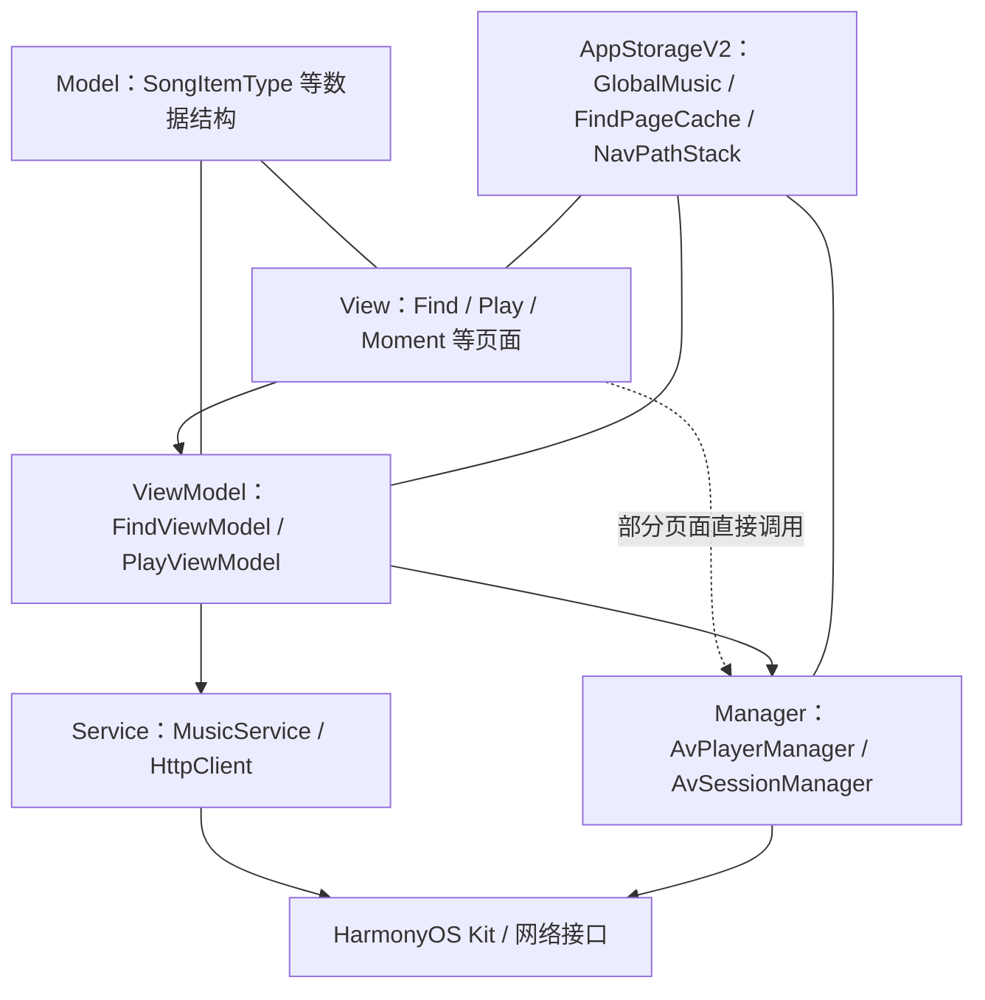
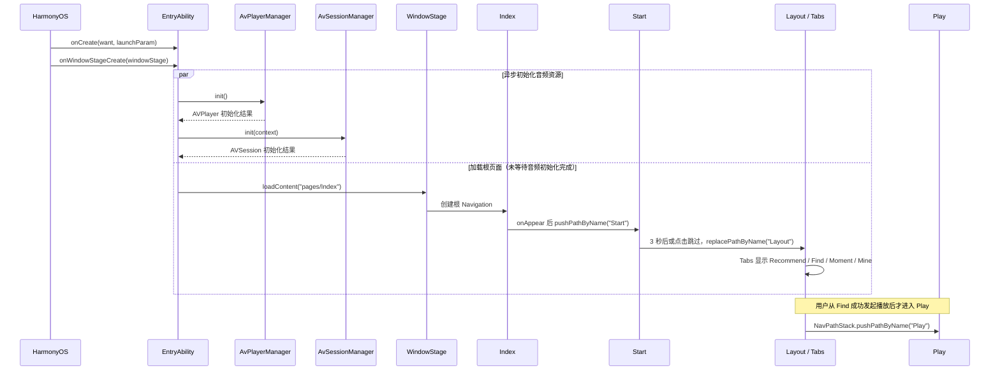
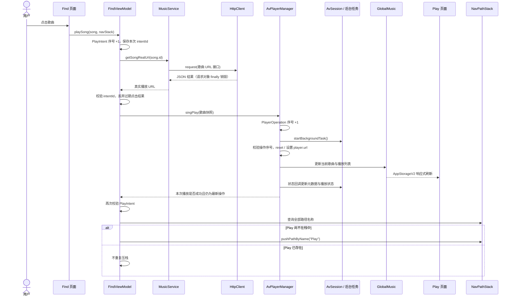

# Day 2 Harmony-CloudMusic 项目架构分析

> 本文依据当前仓库中的 ArkTS 源码、路由与模块配置整理，目标是帮助初学者理解项目的分层、导航、播放链路和资源生命周期。

## 1. 项目整体结构

项目运行在 **HarmonyOS NEXT**，使用 **ArkTS / ArkUI** 构建声明式界面。整体上采用 MVVM 思路：页面负责展示与交互，ViewModel 编排页面业务，Service 访问网络；同时，播放相关能力由全局 Manager 封装，并用 **AppStorageV2** 中的响应式对象在多个页面和 Manager 之间共享状态。

系统能力方面，项目使用 **AVPlayer** 播放音频、**AVSession** 对接系统媒体会话，并通过后台长时任务保持音频播放；网络访问由 `MusicService` 和 `HttpClient` 分层完成。

配置上，`module.json5` 把 `EntryAbility` 声明为模块入口并启用 `audioPlayback` 后台模式，同时申请网络和后台持续运行权限、引用路由表；主页面配置只登记 `pages/Index`，其余页面由 `Navigation` 路由表接入。

因此，当前项目适合概括为：**以 MVVM 为主，配合全局播放 Manager 和共享响应式状态的客户端架构。** 它不是完全严格的 MVVM，因为部分页面会直接调用 Manager。

## 2. 核心模块职责

| 模块 | 负责什么 | 不应该负责什么 | 直接依赖 |
|---|---|---|---|
| `EntryAbility` | 作为应用入口，接收 HarmonyOS 生命周期回调；创建窗口内容并启动、释放音频相关资源。 | 不承载具体页面 UI，也不处理歌曲列表等页面业务。 | `UIAbility`、`WindowStage`、`AvPlayerManager`、`AvSessionManager` |
| Navigation / Layout | `Index` 提供根 `Navigation` 和共享 `NavPathStack`；`Start` 负责启动过渡；`Layout` 用 `Tabs` 容纳四个一级页面。 | 不负责搜索、取播放地址或控制底层播放器。 | 路由表、`NavPathStack`、`Recommend`、`Find`、`Moment`、`Mine` |
| `Find` | 展示随机歌曲、AI 提示和刷新状态，把查找与播放流程交给 `FindViewModel`；同时连接共享导航栈、播放状态和页面缓存。 | 不应自行实现 HTTP 请求或维护 AVPlayer 生命周期。 | `FindViewModel`、`GlobalMusic`、`FindPageCache`、`NavPathStack` |
| `Play` | 展示当前歌曲、进度和播放列表，响应暂停、切歌、删除及拖动进度等操作。 | 不应负责解析音乐接口响应或创建播放器资源。 | `PlayViewModel`、`GlobalMusic`、`AvPlayerManager`、`NavPathStack` |
| `Moment` | 展示本地推荐内容，并在点击歌曲时发起播放。 | 不应管理播放器和会话的创建、释放，也不应承担网络服务职责。 | `defaultSongs`、`AvPlayerManager` |
| `FindViewModel` | 编排随机歌曲加载、AI 请求、真实播放地址获取和播放页跳转；用意图序列避免旧异步结果覆盖新点击。 | 不负责绘制组件，也不直接实现 HTTP 协议或 AVPlayer 状态机。 | `MusicService`、`AIAssistant`、`AvPlayerManager`、`NavPathStack`、`FindPageCache` |
| `PlayViewModel` | 管理播放列表面板的显示状态、时间格式化和拖动进度处理。 | 不负责创建 AVPlayer、获取歌曲地址或控制页面栈。 | `AvPlayerManager` |
| `MusicService` | 封装搜索、随机歌曲和真实 URL 查询，把远端数据映射为项目模型。 | 不负责 UI、导航和播放器生命周期。 | `HttpClient`、`ApiConfig`、`SongItemType` |
| `HttpClient` | 为单次请求创建 HTTP 对象，设置超时与请求头，解析 JSON，并在 `finally` 中销毁请求对象。 | 不理解“歌曲”“播放”等业务语义，也不持有长期播放状态。 | HarmonyOS HTTP API |
| `AvPlayerManager` | 以单例方式持有 AVPlayer，处理播放器状态机、播放操作序列、播放列表与全局播放状态。 | 不负责页面布局、路由配置或远端歌曲搜索。 | `media.AVPlayer`、`GlobalMusic`、`AvSessionManager` |
| `AvSessionManager` | 以单例方式持有 AVSession，注册系统媒体控制事件，更新元数据/播放状态，并启停后台音频任务。 | 不负责页面展示或音乐接口访问。 | `AVSession`、后台任务 API、`AvPlayerManager`、`GlobalMusic`、Ability `Context` |
| `GlobalMusic` | 保存当前歌曲、时长、进度、播放状态、模式和播放列表，是播放 UI 与 Manager 的共享响应式状态。 | 不执行网络请求、播放命令或导航操作。 | `AppStorageV2`；被 `Find`、`Play` 和两个播放 Manager 使用 |
| `FindPageCache` | 缓存 Find 页已加载的歌曲，让页面返回后可以复用数据。 | 不负责持久化数据库、网络刷新或播放控制。 | `AppStorageV2`、`Find`、`FindViewModel` |

## 3. 应用启动和页面导航

当前配置只把 `pages/Index` 声明为主页面；`Start`、`Layout` 和 `Play` 通过路由表注册为 `NavDestination`。实际启动与导航顺序如下：

- **UIAbility 与页面不同**：`EntryAbility` 是系统管理的应用能力入口，接收创建、前后台和窗口销毁等生命周期；ArkUI 页面是窗口中展示的组件树，不等同于 Ability。
- **WindowStage 的作用**：它代表 UIAbility 的窗口舞台。`loadContent` 把根页面 `Index` 装入窗口，页面导航从此开始。
- **Index、Start、Layout、Play 的位置**：`Index` 是根页面并创建唯一的 `Navigation`；`Start` 是启动过渡目的地；`Layout` 是一级主界面；`Play` 是播放详情目的地，由 Find 播放成功后压入同一个导航栈。
- **Tabs 与 Navigation 的区别**：`Navigation` 管理 `Start`、`Layout`、`Play` 等页面目的地的栈式前进、替换和返回；`Tabs` 只在 `Layout` 内切换四个固定一级栏目，不产生新的导航栈页面。

需要注意：`onWindowStageCreate` 调用异步音频初始化后，没有等待它完成便立即执行 `loadContent`。因此“初始化播放器/会话”和“加载页面”实际并行推进，不能理解为页面出现前音频资源一定已经就绪；当前播放入口会对播放器未初始化的情况返回失败。

## 4. 歌曲播放数据流

下图以当前 Find 页点击歌曲为主链路。它同时标出了三个已经存在的并发保护：`FindViewModel` 的 **PlayIntent 序列**、`AvPlayerManager` 的 **PlayerOperation 序列**，以及进入 `Play` 前基于导航栈名称的**页面去重**。

`PlayIntent` 解决“用户快速连续点击不同歌曲时，较慢的旧网络结果最后返回”的问题；`PlayerOperation` 保护播放器在异步后台任务、重置和切歌过程中不应用已过期操作。播放页去重只阻止重复 `push`，不会把已存在但不在栈顶的 `Play` 主动切回栈顶。

`Moment` 的路径更短：页面直接把本地 `SongItemType` 交给 `AvPlayerManager.singPlay`，不会经过 `FindViewModel`、网络取真实 URL或跳转 `Play` 的流程。`Play` 页面本身也会直接调用 Manager 完成暂停、上一首、下一首和删除；拖动进度则经过 `PlayViewModel` 调用 Manager。

## 5. 状态与资源所有权

| 资源或状态 | 创建者 | 持有者 | 使用者 | 释放位置 |
|---|---|---|---|---|
| AVPlayer | `AvPlayerManager.init()` | 单例 `AvPlayerManager` | Manager 内部播放控制；间接服务于各页面 | `EntryAbility.onWindowStageDestroy` 调用 `AvPlayerManager.release()` |
| AVSession | `AvSessionManager.init(context)` | 单例 `AvSessionManager` | 系统媒体控制、`AvPlayerManager` 状态同步 | `EntryAbility.onWindowStageDestroy` 调用 `AvSessionManager.destroy()` |
| 后台长时任务 | `AvSessionManager.startBackgroundTask()`，首次播放时按需启动 | `AvSessionManager` 记录运行状态，系统实际托管任务 | 音频播放链路 | `AvSessionManager.destroy()` 内先调用停止后台任务 |
| `GlobalMusic` | 各使用方通过 `AppStorageV2.connect(GlobalMusic, SONG_KEY, ...)` 取得共享实例 | `AppStorageV2` 共享状态容器 | `Find`、`Play`、`AvPlayerManager`、`AvSessionManager` | 未看到显式删除；播放器释放时会重置字段，存储实例的最终回收时机需要进一步确认 |
| `FindPageCache` | `Find` 通过 `AppStorageV2.connect` 创建或连接 | `AppStorageV2` 共享状态容器 | `Find`、`FindViewModel` | 未看到显式删除；最终回收时机需要进一步确认 |
| HTTP 请求对象 | `HttpClient.request()` 为每次请求调用 `http.createHttp()` | `request` 方法的局部变量 | 单次音乐服务请求 | `HttpClient.request()` 的 `finally` 中调用 `destroy()` |

多个页面和 Manager 使用同一个 `SONG_KEY` 连接 `GlobalMusic`，所以它们观察的是同一份播放状态。Manager 修改歌曲、进度或暂停状态后，`Play` 等页面可由 AppStorageV2 的响应式机制刷新，无需逐页传参或手工广播。

AVPlayer、AVSession、后台任务和 HTTP 对象都占用系统资源，因此创建与释放必须成对：否则可能遗留播放器回调、媒体会话、后台任务或网络句柄。当前 `EntryAbility` 按“先销毁 Session（包括后台任务），再释放 Player”的顺序收尾，方向是明确的。

`AvSessionManager` 是模块级单例，却保存了由 `EntryAbility` 传入的 `Context`。这种引用不能比所属 Ability 生命周期更长；当前 `destroy()` 会销毁会话和停止后台任务，但没有把保存的 `Context` 清空。若 Ability/窗口被重建，旧 Context 的持有与替换边界需要进一步确认。

## 6. 当前架构结论

1. **这个项目是否属于严格 MVVM？** 不是。它以 MVVM 为主，但全局播放 Manager 和共享状态构成了另一条跨页面链路，部分页面还直接调用 Manager。
2. **哪些页面绕过 ViewModel 直接调用 Manager？** `Moment` 直接调用 `AvPlayerManager.singPlay`；`Play` 直接调用暂停、播放、上下曲和删除等方法。`Play` 的拖动进度会先进入 `PlayViewModel`，再由 ViewModel 调用 Manager。
3. **Service 和 Manager 的职责有什么区别？** Service 面向外部数据访问，通常按请求完成搜索、URL 查询和响应映射；Manager 持有 AVPlayer、AVSession 等长期系统资源，协调全局播放行为及其生命周期。
4. **当前架构做得较好的三点是什么？** ① 网络层用 `MusicService` 与 `HttpClient` 分开业务语义和协议细节；② 播放器、会话与后台任务集中在 Manager，入口 Ability 统一初始化和释放；③ `PlayIntent`、`PlayerOperation` 和导航去重分别保护网络结果、播放器操作和页面栈，并发边界较清楚。
5. **当前最值得后续改进的三点是什么？** ① 统一页面到播放能力的调用边界，减少 `Moment`、`Play` 对 Manager 的直接依赖；② 明确单例 Manager、Ability Context 与窗口重建之间的生命周期契约，并在销毁时清理引用；③ 为异步音频初始化建立可观察的就绪状态，同时让网络层保留可区分的错误信息，而不是主要以 `null` 表示失败。

综合来看，当前代码确实符合：**“以 MVVM 为主，配合全局播放 Manager 和共享响应式状态的客户端架构。”**

## 7. 我今天必须理解的内容

- `EntryAbility` 是系统能力入口，不等于 ArkUI 页面。
- `WindowStage.loadContent` 装载根页面；当前页面加载与音频初始化会并行推进。
- ViewModel 负责页面业务流程，Service 负责外部数据访问。
- Manager 负责长期系统资源和全局播放行为。
- `GlobalMusic` 是多个页面与 Manager 共享的响应式播放状态。
- `Navigation` 管理页面栈，`Tabs` 管理 `Layout` 内固定栏目切换。
- AVPlayer、AVSession 和后台任务的创建、使用、释放必须有明确归属并成对出现。
- 当前项目以 MVVM 为主，但不是完全严格的 MVVM。
